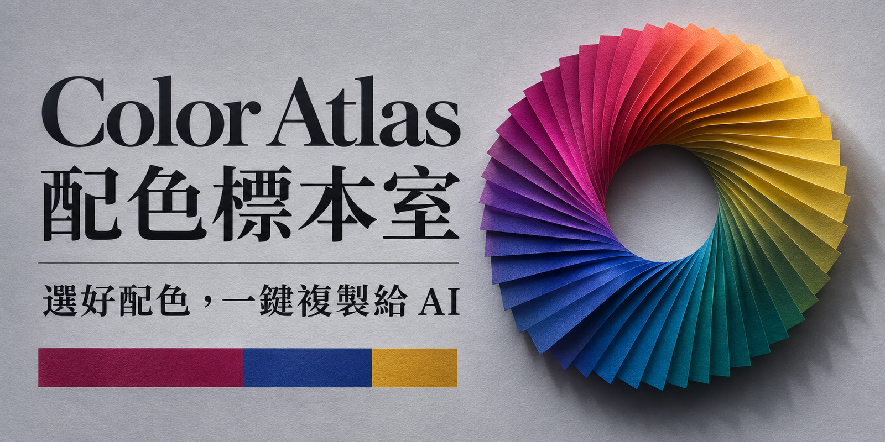

# 配色標本室

打開[配色標本室](https://gwolf0719.github.io/site-color-atlas/)，點選 Three.js 色環上的主色，再從同一批搭配色選背景與輔助色。首頁的「專案色票」直接列出每色的角色、HEX 與面積。點「調整配色」可修改角色和百分比，整段複製給 AI，或用網址分享同一組配色。

## 入口與維護

- `index.html` 與 `style.css` 提供公開介面、版型與主要操作。
- `palettes.json` 存放色卡 ID、名稱、用途、明暗、說明與八個色彩角色。團隊確認選色後可從 [JSON](https://gwolf0719.github.io/site-color-atlas/palettes.json) 依 ID 讀取。既有 ID 用於分享連結，請維持穩定。
- `hunt.js` 載入參考色庫並依主色搜尋搭配。舊網址 `?palette=risograph&view=system#preview` 直接把該組色碼帶入首頁，`404.html` 把舊路徑導回畫布。
- 本機執行 `python3 -m http.server 8106 --bind 127.0.0.1`，並以瀏覽器開啟。發布來源為 GitHub Pages 的 main 分支根目錄。
- 執行 `python3 check.py` 及 `node --check mixer.js`，再以瀏覽器核對選色、移除、比例、複製與分享。

## 動態色環與 AI 配置表

首頁用 Three.js 顯示可選色塊。以 48 個色相、6 階明度與 4 階彩度構成色環，經色域篩選保留 1,095 個色階。可直接輸入指定 HEX，或在挑選時瀏覽全色環。每次依主色與上次選色最多提供 72 個候選，每批 12 色。每份配置表最多八色。後加入色的預設面積會隨順序與色差縮小。百分比欄可手動調整，其他色按比例重新分配，合計 100%。「複製整段給 AI」含字母、角色、HEX 與最終百分比。既有 64 組團隊色卡連結可直接還原至畫布。自由搭配的面積比例描述視覺構成，文字與底色仍需針對實際元件檢查。

- `spectrum.mjs` 定義分層色環、色碼審核與配色推薦。
- `mixer-data.mjs` 定義比例計算與序列化；`mixer.js` 連接色環、配置表與分享網址。
- `ring.js` 產生立體色環、選色過渡、指標抬起與內圈面積顯示。減少動態偏好使用靜態角度，WebGL 不可用時改以可點選的平面色環。
- `vendor/three.js` 為 Three.js 0.187.0 的本機 ES module 精簡包，授權見 `vendor/three.LICENSE.txt`。
- 執行 `node --test mixer.test.mjs` 檢查推薦、比例與分享還原。

## 來源與選色規則

Color Hunt 公開最新動態在 2026-11-18 依序讀取 108 個非空分頁，下一頁回傳空陣列。快照存放於 `colorhunt.json`，共 4,303 組、14,489 個不重複 HEX，保留原卡順序。989 組通過篩選的原卡與團隊配置在背景提供推薦。[Color Hunt](https://colorhunt.co/)

參考 [Paletton](https://paletton.com/) 的色相關係。本站以 HSL 計算鄰近、互補及分裂互補角度，在每批一起推薦。文字可讀性另依實際配對檢查 4.5∶1。畫布推薦會混入與目前主色接近的案例用色。每色可指派背景、主色、輔助色或其他，調整後可分享或複製給 AI。

- `hunt.js` 讀公開快照、過濾色域、依角色提供參考顏色。快照為當日資料。
- `color-rules.mjs` 對應色彩角色、挑選預覽文字色與顯示對比。

## 色紙轉盤與試放

首頁的 Three.js 色環由徑向摺面展開，橫拖轉動，輕點選色，滑鼠移入即依正式面積預覽，移開還原。手機長按試色。預選背景也會暫時套用到檯面。精準選單提供單點試放及指定 HEX。九階灰色可設為底色或加入配色。點已選色帶、轉盤比例環或配置表的色塊即可移除該色；其他色保留角色並按原權重換算為合計 100%。配置表可直接移動相鄰色紙的交界，也可用交界選單、加減按鈕與方向鍵調整。可在同一畫面調整後直接複製給 AI。右上角「重設」恢復初始轉盤、灰階模式和比例，並清除網址內的選色紀錄。

- 紙張幾何與檯面光影見 `chromatic-scene.js`。手勢、渲染與減少動態設定見 `ring.js`。
- 中央構圖與動態編排見 `motion-studio.css`，色片收取與並置比較見 `motion-studio.mjs`。試色條、交界事件與比例轉移見 `paper-interactions.mjs`。
- 研究先例、產品假設及真人測試方法見[互動研究](docs/interaction-research.md)。

## 商業試色

新配色預設為通用，可在「調整配色」展開細部設定。commercial-color.mjs 依品牌官網、商品導購或資訊系統，計算實際字色、邊界與對比，並支援較低彩度的主色試放。面積由使用者決定。分享網址記住用途，AI 輸出附上正式色碼和元件用法。執行 node --test mixer.test.mjs 核對色域、主要文字配對與試放行為。研究來源與適用界線見[商業配色研究](docs/commercial-color.md)。

轉盤、推薦與灰階色票共用角色試放。滑過色票，既有轉盤背景、主標題、複製按鈕、角色標記與頁首細線直接換色。移開還原，點擊才保存。預覽邏輯與觸控／鍵盤事件見 live-proof.mjs，瀏覽器核對移入與移開前後的色碼、角色及分享網址。

首頁支援直接輸入 HEX，主色選定後會接續推薦底色與輔助色。主色、底色和輔助色齊備時提示可複製；單色也可匯出。手機依操作順序排列標題、色環、選項與專案色票。AI 配置表將品牌及裝飾用色限定於已選色碼，另列文字對比用色。

「並置比較」在原位置切換成兩塊等面積的底色，中央色塊使用相同 HEX。優先取專案主色、背景與輔助色，尚未選色時採示範值。此練習參考 Josef Albers 的色彩相對性研究。[Interaction of Color](https://yalebooks.yale.edu/book/9780300179354/interaction-of-color/)
